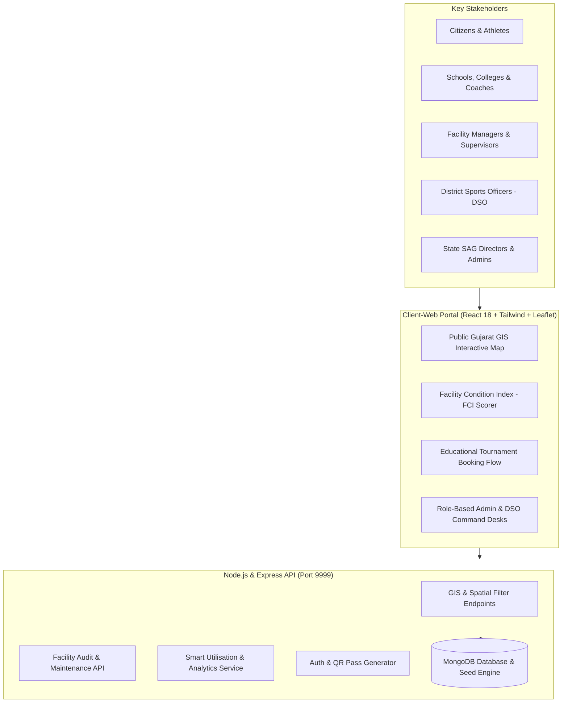

# 🏟️ KhelGujarat GIS - Sports Infrastructure Assessment, Mapping & Utilisation Platform

> **Problem Statement ID:** PS000012  
> **Industry / Department:** Sports, Youth & Cultural Activities Department, Government of Gujarat  
> **Partner Entity:** Sports Authority of Gujarat (SAG) (`nsc-sag@gujrat.gov.in`)  
> **Theme:** Digital Solution for Assessment, Mapping, and Better Utilisation of Sports Facilities Across Gujarat  

---

## 🌟 Executive Summary

Sports facility information across Gujarat has historically been fragmented, making it challenging for state administrators, district sports officers, coaches, schools, and citizens to assess infrastructure availability, condition, and actual utilisation.

**KhelGujarat GIS** solves this problem by delivering a unified, state-of-the-art digital infrastructure platform comprising:
1. **Interactive GIS Gujarat Map:** Visualizing sporting infrastructure across all **33 districts of Gujarat** with multi-sport filtering, live condition-coded pins, and proximity detection.
2. **Facility Condition Assessment System (FCI):** A quantitative framework evaluating turf/court wear, floodlight lux, sanitation, and Divyangjan (para-athlete) barrier-free accessibility.
3. **Smart Utilisation & Institutional Allocation Engine:** Allowing educational institutions (schools, colleges, universities) to reserve grounds for annual sports meets and Khel Mahakumbh trials, while citizens can book pay-and-play slots with instant QR passes.
4. **Multi-Stakeholder Portals:** Tailored workflows for State SAG Directors (Role 5), District Sports Officers / DSOs (Role 4), Sports Complex Managers (Role 3), Coaches (Role 2), and Athletes/Citizens (Role 0).

---

## 🏛️ System Architecture



---

## 🗄️ Database Setup & Configuration

The application uses **MongoDB** with Mongoose ODM. You can run MongoDB locally, via MongoDB Compass, or via a free MongoDB Atlas Cloud cluster.

### Step 1: Configure Environment Variables
Inside `sfic/`, ensure `.env` contains your MongoDB connection string:

```env
PORT=9999
ACCESS_TOKEN_SECRET=khelgujarat_secret_key_2026_sports_dept
MONGO_URI=mongodb://localhost:27017/sfic
EMAIL=noreply.sag.gujarat@gmail.com
PASSWORD=demo_password
```

> **For MongoDB Atlas (Cloud Database):**  
> If using MongoDB Atlas, replace `MONGO_URI` with your connection string:  
> `MONGO_URI=mongodb+srv://<username>:<password>@cluster0.mongodb.net/sfic?retryWrites=true&w=majority`

### Step 2: Run the Automated Database Seeder
To instantly populate the database with all 33 Gujarat districts, verified SAG sports complexes, sports categories, inspection checklists, and official demo accounts, run:

```bash
cd sfic
npm run seed
```

Output:
```
=================================================
 Connecting to MongoDB at: mongodb://localhost:27017/sfic
=================================================
 Connected to MongoDB successfully.

1. Seeding Gujarat 33 Districts...
   Seeded 33 districts.
2. Seeding Sports...
   Seeded 12 sports.
3. Seeding Complaint Categories...
   Seeded 6 complaint types.
4. Seeding Official Users (Admin, DSO Authorities, Managers, Athletes)...
   Seeded 6 primary official and demo users.
5. Seeding Gujarat Sports Complexes with GIS and FCI Ratings...
   Seeded 6 Gujarat Sports Complexes with GeoJSON coords.

=================================================
 DATABASE SEEDING COMPLETED SUCCESSFULLY!
=================================================
```

---

## 🚀 Quick Start Guide

### 1. Prerequisites
- **Node.js**: v18.0.0 or higher (v22 tested)
- **npm**: v9.0.0 or higher
- **MongoDB**: Local `mongod` or MongoDB Atlas URI (built-in demo dataset automatically serves if MongoDB is offline)

### 2. Start the Backend Server (Port 9999)
```bash
cd d:\projects\sfic
npm install
npm start
```
*Server starts at `http://localhost:9999`.*

### 3. Start the Web Portal (Port 3000)
```bash
cd d:\projects\sfic\client-web
npm install
npm start
```
*Web app launches automatically at `http://localhost:3000/`.*

---

## 🔑 Pre-Configured Demo Credentials

The platform includes 1-click quick-login buttons on both the public navbar and the login page:

| Role | Name & Department | Email | Password | Role ID |
| :--- | :--- | :--- | :--- | :---: |
| **State Admin** | Dr. Arvind Patel, IAS (Director General, SAG) | `admin@sag.gujarat.gov.in` | `admin` | 5 |
| **DSO Authority** | Shri Bhavik Solanki (DSO Ahmedabad) | `dso.ahmedabad@sag.gujarat.gov.in` | `dso` | 4 |
| **DSO Authority** | Shri K. L. Parmar (DSO Vadodara) | `dso.vadodara@sag.gujarat.gov.in` | `dso` | 4 |
| **Complex Manager** | Rajesh Vaghela (Khokhra Sports Complex) | `manager.khokhra@sag.gujarat.gov.in` | `manager` | 3 |
| **Complex Manager** | Mehul Choksi (Sama Sports Complex) | `manager.sama@sag.gujarat.gov.in` | `manager` | 3 |
| **Citizen Athlete** | Aarav Trivedi (Competitive Badminton) | `athlete.aarav@gmail.com` | `athlete` | 0 |

---

## 📋 Features Aligned with PS000012

### 1. Assessment (Facility Condition Index - FCI)
- Multi-component scorecard assessing:
  - Playing Surface / Turf Quality (25 pts)
  - Lighting & Floodlight Lux (20 pts)
  - Hygiene, Sanitation & Locker Rooms (20 pts)
  - Structural Safety & Perimeter Fencing (15 pts)
  - Divyangjan / Para-Athlete Barrier-Free Accessibility (20 pts)
- Generates an automated FCI Grade (A, B, C, D) and maintenance urgency priority.

### 2. Mapping (Interactive GIS Gujarat Engine)
- OpenStreetMap / Leaflet GIS map with dynamic color-coded markers.
- Multi-parameter filters: District (33 districts), Sport (12 sports), Category, and FCI Grade.
- GPS Geolocation "Find Near Me" feature sorting nearest venues.

### 3. Better Utilisation
- Peak (6–9 AM, 5–8 PM) vs Off-Peak (11 AM–4 PM) occupancy analytics.
- Educational Institution ground reservations for schools, colleges, and Khel Mahakumbh trials.
- Instant Digital QR Entry Pass issuance for citizen pay-and-play sessions.

---

## 👥 Contributors & Acknowledgments
- Developed for **Sports, Youth & Cultural Activities Department, Government of Gujarat**
- Reference Problem Statement: **PS000012**
- Department Email: `nsc-sag@gujrat.gov.in`
